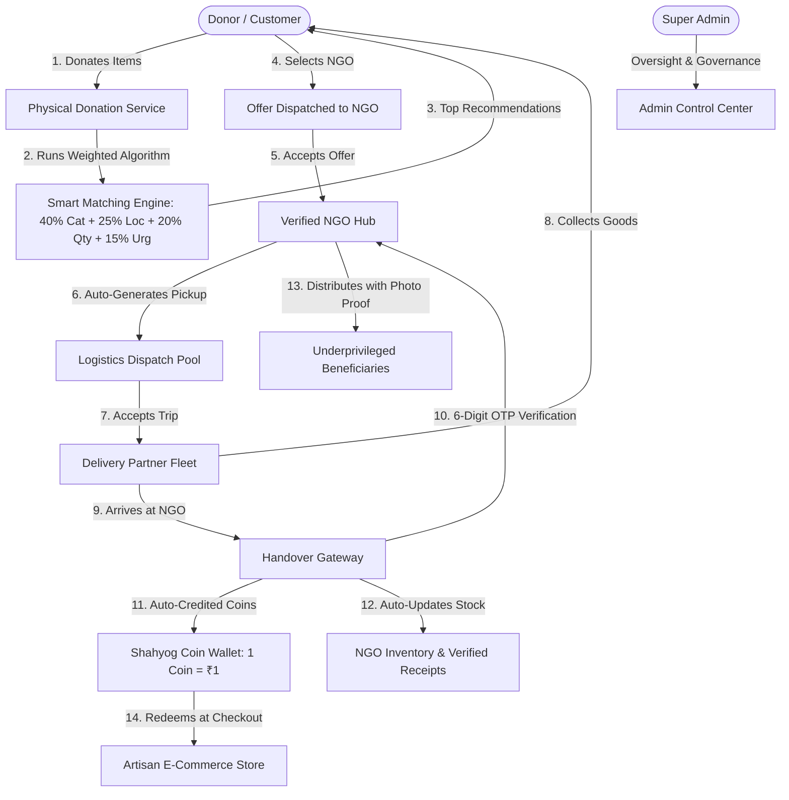

# Shahyog Kart (सहयोग कार्ट)
> **Shop with Purpose, Donate with Love.**  
> India's premier integrated social commerce and donation ecosystem connecting Donors, Verified NGOs, Logistics Fleets, Rural Artisans, and Conscious Shoppers.

---

## 📖 Table of Contents
1. [Overview & Core Value Proposition](#-overview--core-value-proposition)
2. [Full-Stack Architecture & Tech Stack](#-full-stack-architecture--tech-stack)
3. [System Architecture & Lifecycle Workflow](#-system-architecture--lifecycle-workflow)
4. [Role-Based Access Control (RBAC)](#-role-based-access-control-rbac)
5. [Database Architecture & Schema](#-database-architecture--schema)
6. [Complete REST API Reference](#-complete-rest-api-reference)
7. [Smart NGO Matching Algorithm Formula](#-smart-ngo-matching-algorithm-formula)
8. [Delivery OTP Verification & Proof-of-Impact](#-delivery-otp-verification--proof-of-impact)
9. [Shahyog Coins & Reward Economics](#-shahyog-coins--reward-economics)
10. [Notification Engine](#-notification-engine)
11. [Installation & Local Setup Guide](#-installation--local-setup-guide)
12. [Testing & Quality Assurance](#-testing--quality-assurance)
13. [Default Seeded Credentials](#-default-seeded-credentials)
14. [Production Deployment & Cloud Setup](#-production-deployment--cloud-setup)
15. [Documentation Suite](#-documentation-suite)

---

### 📚 Dedicated Documentation Links
- [API Documentation](file:///c:/Users/Visha/OneDrive/Desktop/kart/API_DOCUMENTATION.md)
- [Database Setup & Schema Guide](file:///c:/Users/Visha/OneDrive/Desktop/kart/DATABASE_SETUP.md)
- [Production Deployment Guide](file:///c:/Users/Visha/OneDrive/Desktop/kart/DEPLOYMENT_GUIDE.md)
- [Testing & QA Guide](file:///c:/Users/Visha/OneDrive/Desktop/kart/TESTING_GUIDE.md)

---

## 🌟 Overview & Core Value Proposition

**Shahyog Kart** unifies two traditionally separated ecosystems:
1. **Conscious E-Commerce**: An artisan and ethical marketplace where sales empower local rural producers and generate automatic fractional social donations.
2. **Doorstep Physical Donation & Smart Matching**: A digital pipeline enabling citizens to donate essential items (Books, Clothes, Shoes, Food, Stationery, Toys, Blankets, Household Essentials). A weighted matching algorithm matches items to verified NGO requirements, arranges courier pickups, verifies custody with cryptographic OTPs, awards **Shahyog Reward Coins** (redeemable for shopping discounts), and closes the loop with verifiable beneficiary distribution photographs.

### Brand Palette & Visual Identity
- **Deep Green** (`#064e3b` / `#022c22`): Sustainability, security, growth, ethical governance.
- **Orange** (`#f97316` / `#ea580c`): Energy, benevolence, Indian festive warmth, urgency.
- **White & Light Gray** (`#ffffff` / `#f9fafb`): Modern minimalism, clean data legibility.

---

## 💻 Full-Stack Architecture & Tech Stack

```
shahyog-kart/
├── backend/                  # Node.js + Express REST API Server
│   ├── src/
│   │   ├── config/          # MySQL Connection Pool & Schema DDLs
│   │   ├── controllers/     # Modular Request Handlers (Auth, Orders, NGOs, Admin, etc.)
│   │   ├── middleware/      # JWT Authenticate, RBAC Authorize, Multer Upload, ErrorHandler
│   │   ├── routes/          # Express API Routers
│   │   ├── services/        # Business Logic (matchingService, deliveryService, coinService, notificationService)
│   │   └── server.js        # Main Express App
│   ├── test_complete_integration_phase4.js # Phase 4 17-Step E2E Integration Suite
│   ├── test_full_platform_regression_phase3.js # Phase 1-3 Full Regression Suite
│   └── package.json
└── frontend/                 # React.js + Vite Single Page Application
    ├── src/
    │   ├── api/             # Axios Interceptors with Bearer Token Injection
    │   ├── components/      # Reusable UI (Navbar, Footer, Modal, StatusBadge, ProductCard)
    │   ├── context/         # AuthContext & CartContext (Persistent State)
    │   ├── pages/           # AdminDashboard, NgoDashboard, DeliveryDashboard, Shop, Donate, etc.
    │   ├── App.jsx          # Route Definitions & Protected Route Guards
    │   └── main.jsx
    └── package.json
```

- **Frontend**: React 18, Vite 6, Tailwind CSS 3, React Router v6, Axios, Lucide React icons.
- **Backend**: Node.js v20+, Express.js, MySQL2 (with atomic connection pool and transaction rollbacks), JWT (`jsonwebtoken`), `bcryptjs`, `dotenv`, `cors`, `uuid`.
- **Database**: MySQL 8.0 relational database with strict foreign key constraints and indexed lookup paths.

---

## 🔄 System Architecture & Lifecycle Workflow



---

## 👥 Role-Based Access Control (RBAC)

The platform enforces five distinct persona roles:

| Role | Access Level | Verification Requirement | Capabilities |
|---|---|---|---|
| **Customer / Donor** | Public & Authenticated | Instant Email Activation | Browse catalog, buy artisan products, donate items or funds, track shipments, earn & redeem coins. |
| **NGO Partner** | NGO Organization | Admin Verification Required | Publish requirements, review incoming donation offers, receive goods via OTP, manage inventory, log distribution proofs. |
| **Delivery Partner** | Courier Fleet | Admin Verification Required | View available geo-tagged pickups, accept trips, update transit milestones, submit NGO handover OTP. |
| **Seller** | Rural Artisan / Store | Admin Verification Required | Manage inventory, add products, adjust pricing, manage incoming orders, track payouts. |
| **Admin** | System Operator | Pre-seeded Super User | Platform analytics, verify/suspend users, monitor all deliveries, resolve stuck trips, configure coin rules, delist products. |

---

## 🗄️ Database Architecture & Schema

The MySQL schema is partitioned across modular, relational tables:

1. **`users`**: Master authentication, hashed passwords, roles (`customer`, `ngo`, `delivery`, `seller`, `admin`), status (`pending`, `approved`, `active`, `suspended`), coin balances.
2. **`products`**: E-commerce items with seller association, stock, price, category, and donation percentage.
3. **`categories`**: Product classifications with images and descriptions.
4. **`carts` & `cart_items`**: Persistent shopping carts per user.
5. **`orders` & `order_items`**: Completed transactions, tax, subtotal, coin redemption discounts, and status progression.
6. **`addresses`**: User shipping and pickup addresses with geographic coordinates.
7. **`donations`**: Master records for both monetary donations and physical item donations with 11-stage tracking.
8. **`donation_images`**: Multi-photo attachments for item condition inspection.
9. **`ngos`**: Verified NGO profiles, 80G/12A registration numbers, contact person, accepted categories, coordinates, capacity limits.
10. **`ngo_requirements`**: Demand-driven NGO needs with priority levels (`Urgent`, `High`, `Medium`, `Low`) and fulfillment tracking.
11. **`ngo_inventory`**: Live warehouse inventory categorized by item type, condition, and distributed quantities.
12. **`donation_matching` & `matching_scores`**: Algorithmic matching audits, breakdown scores, and offer acceptance state.
13. **`ngo_receipts`**: Official receipt logs with serial codes generated upon physical custody handover.
14. **`delivery_partners`**: Courier profiles, vehicle classifications, driver license numbers, and ratings.
15. **`pickup_requests`**: Doorstep dispatch requests generated automatically upon NGO offer acceptance.
16. **`delivery_assignments`**: Active courier trips with assignment codes and milestone timestamps.
17. **`delivery_tracking`**: Chronological breadcrumb audit log of geographic coordinates and driver remarks.
18. **`delivery_verification`**: Secure 6-digit OTP verification records with expiration and brute-force attempt limits.
19. **`distribution_records`**: Ground-level proof reports of beneficiary distribution with photo evidence and beneficiary counts.
20. **`coin_transactions`**: Double-entry ledger of coin earnings and order redemptions with balance tracking.
21. **`reward_rules`**: Admin-configurable coin award policies per item unit.
22. **`notifications`**: User alert stream for 9 platform lifecycle milestones with unread counters.

---

## 📡 Complete REST API Reference

### 1. Authentication (`/api/auth`)
- `POST /api/auth/register` - Register customer, NGO, courier, or seller.
- `POST /api/auth/login` - Authenticate and receive signed JWT.
- `GET /api/auth/profile` - Get authenticated user profile.
- `PUT /api/auth/profile` - Update user details.
- `POST /api/auth/forgot-password` - Request password reset token.

### 2. Physical Item Donations (`/api/donations/items`)
- `POST /api/donations/items` - Submit physical donation (Books, Clothes, Shoes, Food, etc.).
- `GET /api/donations/items/my` - List donor's item donations.
- `GET /api/donations/items/:id/recommendations` - Run Smart Matching algorithm and fetch ranked NGOs.
- `POST /api/donations/items/:id/offer` - Send donation offer to selected NGO.
- `GET /api/donations/items/track/:identifier` - Get 11-stage chronological tracking timeline and distribution proof.

### 3. NGO Hub (`/api/ngo`)
- `GET /api/ngo/overview` - Real-time NGO KPI overview.
- `GET /api/ngo/requirements` - Fetch active community needs.
- `POST /api/ngo/requirements` - Publish new requirement with urgency level.
- `GET /api/ngo/incoming-donations` - View offered donations.
- `POST /api/ngo/offers/:matchingId/respond` - Accept or reject donation offer (triggers pickup request).
- `GET /api/ngo/deliveries/arriving` - View arriving couriers and active handover OTP codes.
- `GET /api/ngo/inventory` - View live item inventory and stock.
- `POST /api/ngo/distributions` - Record beneficiary distribution with photo evidence and headcount.
- `GET /api/ngo/distributions` - View distribution audit log.

### 4. Logistics & Delivery (`/api/delivery`)
- `GET /api/delivery/overview` - Driver performance metrics.
- `GET /api/delivery/available-pickups` - View open doorstep pickups in courier's operating city.
- `POST /api/delivery/pickups/:id/accept` - Accept pickup request and create active assignment.
- `PATCH /api/delivery/assignments/:id/status` - Update progression: `Out for Pickup` ➔ `Collected` ➔ `Out for Delivery` ➔ `Arrived at NGO`.
- `POST /api/delivery/assignments/:id/verify-otp` - Submit 6-digit OTP provided by NGO staff to finalize handover.

### 5. Shahyog Coins & Rewards (`/api/coins`)
- `GET /api/coins/my-wallet` - View available coins, rupee value (1 Coin = ₹1), and transaction ledger.
- `GET /api/coins/rules` - View active reward policies per item unit.
- `PUT /api/coins/rules/:id` - (Admin) Update coin rewards per unit or description.

### 6. Notifications (`/api/notifications`)
- `GET /api/notifications` - Fetch user's notification list with unread counter.
- `PATCH /api/notifications/:id/read` - Mark single notification as read.
- `PATCH /api/notifications/mark-all-read` - Mark all notifications as read.

### 7. Super Admin Portal (`/api/admin`)
- `GET /api/admin/stats` - Platform KPIs, beneficiary impact counter, revenue, item category breakdowns.
- `GET /api/admin/users` - Filterable user directory by role and status.
- `PATCH /api/admin/users/:userId/status` - Suspend, reactivate, or approve user accounts.
- `GET /api/admin/verifications` - Pending partner verification queue.
- `PATCH /api/admin/verifications/:userId` - Approve or reject NGO, seller, or courier partner.
- `GET /api/admin/ngos` - Comprehensive NGO directory with requirements and distribution audits.
- `GET /api/admin/donations` - Global donation stream with matching scores.
- `GET /api/admin/distribution-records` - Ground impact photo evidence and beneficiary counts.
- `GET /api/admin/delivery-partners` - Courier fleet directory and vehicle info.
- `GET /api/admin/pickup-requests` - Logistics dispatch monitor.
- `POST /api/admin/pickup-requests/:id/reset` - Intervene and reset stuck pickup trips.
- `GET /api/admin/products` - Product moderation and active/inactive toggle.
- `PATCH /api/admin/products/:id/toggle` - Delist or publish store products.
- `GET /api/admin/orders` - Global order ledger with coin redemption discounts.
- `POST /api/admin/categories` - Create new marketplace category.
- `GET /api/admin/coins/ledger` - Comprehensive coin issuance and redemption ledger.

---

## 🧮 Smart NGO Matching Algorithm Formula

When a donor submits physical goods, the engine ranks verified NGOs using a transparent, multi-factor rule-based algorithm:

$$\text{Final Score} = (\text{Category} \times 0.40) + (\text{Location} \times 0.25) + (\text{Quantity} \times 0.20) + (\text{Urgency} \times 0.15)$$

### Weighted Factors Breakdown:
1. **Category Match (40% Weight)**:
   - 100 points: NGO has an active published requirement for this exact category.
   - 75 points: NGO explicitly accepts this category in its profile.
   - 0 points: Category rejected (excluded from recommendations).
2. **Location Proximity (25% Weight)**:
   - Calculated via Haversine great-circle distance between donor and NGO coordinates.
   - $\le 10\text{ km}$: 100 points.
   - $10 - 25\text{ km}$: 85 points.
   - $25 - 50\text{ km}$: 70 points.
   - $50 - 100\text{ km}$: 50 points.
   - $> 100\text{ km}$: 25 points.
3. **Quantity Match & Capacity (20% Weight)**:
   - Evaluates remaining requirement units and warehouse capacity limit.
   - Exact or under requirement: 100 points.
   - Surplus donation: Scaled proportionally.
4. **Urgency & Priority (15% Weight)**:
   - `Urgent`: 100 points.
   - `High`: 80 points.
   - `Medium`: 60 points.
   - `Low`: 40 points.

---

## 🔐 Delivery OTP Verification & Proof-of-Impact

To eliminate donation leakage and fake delivery claims:
1. When the delivery partner arrives at the NGO facility, a secure 6-digit cryptographic OTP is generated.
2. The OTP is visible only to authorized NGO personnel via the **Arriving Couriers** hub.
3. The delivery partner requests the OTP in person and submits it via their mobile dashboard.
4. The system validates:
   - Exact OTP match.
   - Expiration window (valid for 60 minutes).
   - Maximum attempt protection (maximum 5 failed attempts before invalidation).
5. Upon successful OTP verification:
   - Custody is cryptographically verified.
   - Official NGO Receipt (`RCPT-YYYYMMDD-XXXXXX`) is generated.
   - NGO inventory is updated.
   - **Shahyog Coins are credited to the donor's wallet**.
   - Donor receives immediate notification.

---

## 🪙 Shahyog Coins & Reward Economics

- **Core Rule**: Coins are **never** awarded on donation submission. They are credited **only** upon physical handover and OTP verification.
- **Conversion Rate**: $1\text{ Shahyog Coin} = ₹1.00\text{ INR}$.
- **Reward Rules (Configurable by Admin)**:
  - Books: 10 Coins / unit (e.g. 20 Books = 200 Coins = ₹200).
  - Clothes / Jackets: 20 Coins / unit.
  - Shoes: 10 Coins / pair.
  - Stationery: 3 Coins / unit.
  - Blankets: 25 Coins / unit.
  - Household Essentials: 15 Coins / unit.
- **Redemption during Shopping**:
  - Customers can redeem up to 50% of product value using available coins at checkout.
  - Prevents double-spend via row-level locks and atomic database transactions.

---

## 🔔 Notification Engine

Database-backed notification engine delivering automated alerts across all key milestones:
1. `Donation Submitted Successfully`
2. `Donation Offer Dispatched to NGO`
3. `Donation Accepted by NGO`
4. `Courier Assigned for Doorstep Pickup`
5. `Items Collected from Doorstep`
6. `Courier Arrived at NGO Facility`
7. `Donation Safely Received & Verified via OTP`
8. `Reward Coins Credited to Wallet`
9. `Direct Ground Impact (Beneficiary Distribution)`
10. `Order Placed Successfully`

---

## 🚀 Installation & Local Setup Guide

### Prerequisites
- Node.js v18.0.0 or higher
- MySQL Server 8.0 running on `localhost:3306`
- npm v9+

### 1. Database Setup
Log into MySQL and initialize the database:
```sql
CREATE DATABASE IF NOT EXISTS shahyog_kart CHARACTER SET utf8mb4 COLLATE utf8mb4_unicode_ci;
```

Run the schema migration and seeding scripts from `backend/`:
```bash
cd backend
npm install
node src/scripts/seed_phase1.js
node src/scripts/seed_phase2.js
node src/scripts/seed_phase3.js
node src/scripts/seed_phase4.js
```

### 2. Backend Setup
1. Create `backend/.env` (see `backend/.env.example`):
```env
PORT=5000
NODE_ENV=development
CLIENT_URL=http://localhost:5173
DB_HOST=localhost
DB_USER=root
DB_PASSWORD=YOUR_PASSWORD
DB_NAME=shahyog_kart
DB_PORT=3306
JWT_SECRET=your_super_secret_jwt_key_shahyog_kart_2026
JWT_EXPIRE=7d
```
2. Start the backend server:
```bash
npm run dev
# Server listens on http://localhost:5000
```

### 3. Frontend Setup
1. Create `frontend/.env` (see `frontend/.env.example`):
```env
VITE_API_URL=http://localhost:5000/api
```
2. Start Vite development server:
```bash
cd ../frontend
npm install
npm run dev
# Frontend runs on http://localhost:5173
```

---

## 🧪 Testing & Quality Assurance

### Run Phase 4 Complete 17-Step E2E Integration Suite
Tests the complete lifecycle end-to-end against live MySQL and Express APIs:
```bash
node backend/test_complete_integration_phase4.js
```

### Run Phase 1, 2 & 3 Full Platform Regression Suite
```bash
node backend/test_full_platform_regression_phase3.js
```

### Build Frontend for Production
```bash
npm run build --prefix frontend
```

---

## 🔑 Default Seeded Credentials

| Persona | Email | Password | Role | Description |
|---|---|---|---|---|
| **Super Admin** | `admin@shahyogkart.com` | `Admin@123` | `admin` | Full governance, verification, and analytics access |
| **Verified NGO** | `ngo@shahyogkart.com` | `Ngo@123` | `ngo` | Pratham Shiksha Foundation (Delhi NCR) |
| **Delivery Courier** | `delivery@shahyogkart.com` | `Delivery@123` | `delivery` | Vikram Singh (Active Motorbike Courier) |
| **Artisan Seller** | `seller@shahyogkart.com` | `Seller@123` | `seller` | Ramesh Patel (Handcrafted Terracotta Crafts) |
| **Customer / Donor** | `customer@shahyogkart.com` | `Customer@123` | `customer` | Aarav Sharma (Active Shopper & Philanthropist) |

---

*Shahyog Kart — Developed with ❤️ for social transformation across India.*
